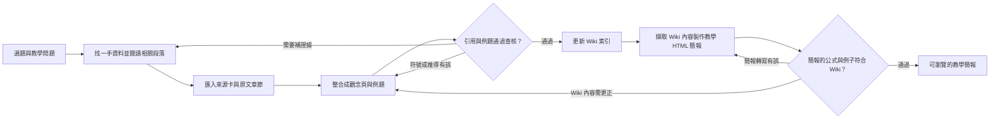

# 建置與查核紀錄

## 先討論，再生成

2026-11-23 的選題從「量子可逆電路」開始。生成 Wiki 前，先在對話中提出教學問題「只看 AND 的輸出，能推回原本的輸入嗎？」並把讀者設定為有基本布林邏輯、初次接觸量子電路的人。以 AND 為例可以先比較資訊遺失與完整輸出，再沿著 Toffoli 閘走到反計算與相位回踢。

這次使用可公開閱讀的論文和 IBM Quantum Learning 課程。三篇研究文獻提供可逆計算和通用性的依據，三頁官方課程提供電路記號、反計算和相位範例。

## 資料怎麼進入 Wiki

本次的 Wiki 循環是「閱讀 → 摘要 → 整合 → 查核 → 回修」。製作簡報時，從已查核的觀念頁擷取內容，再核對投影片的公式與示範輸出。

1. **取得資料**　搜尋一手論文與官方教材，打開原文章節，確認它能回答至少一個教學問題。Bennett 的課程網頁副本開啟時回傳 403，改從 Duke 大學課程儲存的論文掃描版讀取第 525–526 頁。
2. **匯入與整理**　每個來源分配一個固定編號 `S01` 至 `S06`。來源卡保存可回查的連結、定位和摘要，觀念頁按讀者要回答的問題整合多筆來源。像三閘 AND 反計算及三位元相位回踢這類自編例題，依引用的原理自行推導並用計算查核。
3. **查核與回修**　逐項對照來源，核對公式的適用條件，並用小規模窮舉或振幅計算檢查例子。IBM 教材使用 Qiskit 的位元順序，本 Wiki 改用依名稱排列的 `(a,b,t)`。按這個順序重列真值表後，Toffoli 互換的是 `110` 與 `111`。
4. **更新索引**　將每個觀念和來源卡連回 [Wiki 首頁](README.md)，並列出下面的引用與檢查對照，讓之後擷取內容時可以找到原文和算例。

## 知識與查核對照

| Wiki 內容 | 來源依據 | 查核方式 |
| --- | --- | --- |
| [AND 與可逆映射](wiki/01-reversibility.md) | [S01](sources/01-bennett.md)、[S02](sources/02-toffoli.md)、[S04](sources/04-ibm-classical-simulation.md) | 窮舉 4 組 AND 輸入，核對 3 組輸出 `0` 的碰撞。用 XOR 抵消說明一般可逆映射。 |
| [X、CNOT、Toffoli](wiki/02-gates.md) | [S02](sources/02-toffoli.md)、[S03](sources/03-ibm-circuits.md)、[S04](sources/04-ibm-classical-simulation.md) | 對照真值表的 2、4、8 列，檢查輸出各自唯一且套用兩次都能還原。 |
| [酉運算與反轉](wiki/03-unitarity.md) | [S03](sources/03-ibm-circuits.md)、[S04](sources/04-ibm-classical-simulation.md)、[S05](sources/05-ibm-deutsch.md)、[S06](sources/06-barenco.md) | 用 H、S 的矩陣核對正向和反向電路，在兩個計算基底態都還原輸入。 |
| [反計算](wiki/04-uncomputation.md) | [S01](sources/01-bennett.md)、[S04](sources/04-ibm-classical-simulation.md) | 窮舉暫存位元 `w = 0` 時的 8 組 `(a,b,y)`，確認 `w` 還原為 `0` 且輸出 `y ⊕ ab`。 |
| [相位回踢](wiki/05-phase-kickback.md) | [S05](sources/05-ibm-deutsch.md) | 用基底振幅檢查 Toffoli 將 `|+⟩|1⟩|−⟩` 變成 `|−⟩|1⟩|−⟩`，再確認對第一位做 H 後量測必得 `1`。目標改成 `|+⟩` 時，量測必得 `0`。 |

## 如何從 Wiki 產生教學簡報

先從 [閱讀路線](README.md) 取出學習問題，再從相應觀念頁擷取已查核的定義、公式和例題。[HTML 簡報](../quantum-reversible-slides.html)在教學頁連回觀念頁，並在末頁列出六筆來源。判斷題和狀態切換示範沿用真值表或振幅的預期結果。

| 簡報段落 | 從 Wiki 擷取的內容 | 教學呈現方式 |
| --- | --- | --- |
| AND 可以反推嗎？ | [AND 真值表](wiki/01-reversibility.md) | 先顯示輸出 `0`，請讀者找出所有可能輸入。 |
| 目標位元什麼時候會翻轉？ | [Toffoli 真值表](wiki/02-gates.md) | 切換 `a`、`b` 或 `t` 查看輸出，連按兩次核對可逆性。 |
| 怎麼倒轉電路並清除暫存？ | [酉電路的反轉規則](wiki/03-unitarity.md)、[三閘反計算例子](wiki/04-uncomputation.md) | 逐閘展示 `(a,b,w,y)`，指出哪一個暫存位元回到 `0`。 |
| 相位怎麼改變量測？ | [相位回踢算例](wiki/05-phase-kickback.md) | 比較有無 Toffoli 時的相對相位，以及接一個 H 之後的量測結果。 |

在 Chrome 以本機 HTML 開啟簡報，逐一操作八組 Toffoli 輸入，檢查每組套用兩次都能還原。反計算示範選用兩個控制位元皆為 1 的情況，檢查輸出位元起始為 0 與 1 的兩條路徑。相位回踢示範則切換 Toffoli 與 H 的四種組合，比對計算基底的量測機率。

[回到 Wiki 索引](README.md)
